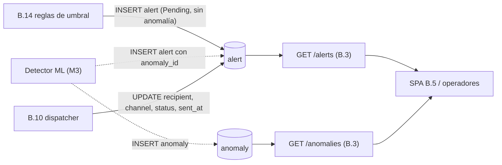

# Design: ISS-B-03 — API de lectura de series, anomalías y alertas

## Enfoque técnico

Mismo patrón en capas que `/metrics/*`:

```
GET /anomalies ──> require_api_key ──> AnomalyService ──> SQLAlchemyAnomalyRepository ──> anomaly ⨝ metric_type
GET /alerts    ──> require_api_key ──> AlertService   ──> SQLAlchemyAlertRepository   ──> alert ⨝ alert_status ⟕ alert_channel
                                            └── read_window (ventana 24 h / 7 d, limit 1..500)
```

- **Router**: deriva el tenant de la key y no acepta parámetro de aplicación. `limit` y `status` van sin `ge`/`le` ni enum en FastAPI, para que el 422 salga del servicio con `ErrorResponse` y no con el `{"detail"}` de la validación de FastAPI (lección de la review de ISS-S3-03).
- **Servicio**: valida ventana, `limit` y `status` antes de tocar la base. El detalle de anomalía levanta `NotFoundError("anomaly_not_found")` tanto si no existe como si es de otro tenant.
- **Repositorio**: una sola sentencia con filtro por tenant y ventana, `ORDER BY ... DESC` con desempate por id, y `LIMIT`. Los catálogos (`metric_type`, `alert_status`, `alert_channel`) se referencian como `TableClause` livianos, igual que en `sqlalchemy_query_repository`.

## Contexto para nuevos integrantes



## Decisiones

| # | Decisión | Alternativas | Trade-off y elección |
|---|----------|--------------|----------------------|
| DT-1 | Migración `0007`: `alert` independiente de `anomaly` (ADR-0012) | Modelo y anomalía falsos por cada alerta de B.14; JOIN a `anomaly` para el tenant | Las alternativas ensucian el dataset de ML o dejan el listado vacío en la v1. Se elige la migración, que es barata porque la tabla está vacía. |
| DT-2 | `severity` TEXT + `ck_alert_severity` | ENUM de Postgres; catálogo SMALLINT | El ENUM es costoso de extender y el catálogo agrega un JOIN sin ganancia. Dominio cerrado, expuesto como string. |
| DT-3 | `recipient` y `channel_id` nullable | Que B.14 resuelva el destino al crear | El destino es configuración del dispatcher (B.10, secretos por entorno). B.14 no debería conocerlo. |
| DT-4 | Índices compuestos newest-first en la misma migración | Índices aparte; ninguno | Sin `(application_id, created_at DESC)` la paginación hace seq scan. La `0004` sentó el precedente de crear el índice con la columna. |
| DT-5 | Helper `read_window` compartido | Duplicar límites en cada servicio, como `session_service` (ISS-S3-03) | Dos servicios con los mismos límites. Cuando entre ISS-S3-03, `session_service` puede migrar al helper (seguimiento). |
| DT-6 | Ventana default de 24 h | 15 min como `/metrics/query` | Los eventos son escasos: 15 min dejaría la respuesta casi siempre vacía. Mismo default que `/sessions`. |
| DT-7 | 404 idéntico para ajena e inexistente | 403 para ajena | Un 403 confirma que el recurso existe bajo otro tenant (ADR-0003). |
| DT-8 | `recipient` fuera de la respuesta | Exponerlo | Es un mail o un chat id: configuración del dispatcher, no un dato de lectura. |
| DT-9 | `/anomalies/{id}` pasa a `/anomalies/{anomaly_id}` | Mantener `{id}` | Convención del contrato (`{user_id}`, `{application_id}`) y del router. La URL no cambia. |

## Coordinación con B.14

- La migración de B.14 tiene que llevar `down_revision = "0007"`. Si arranca antes de que se mergee B.3, se basa en la rama `b-03`. Si no, Alembic queda con dos heads.
- B.14 crea alertas con `application_id`, `severity`, `message` y `status_id` = Pending. Deja `anomaly_id`, `recipient`, `channel_id` y `sent_at` en NULL.
- Las columnas propias de las reglas (umbral, valor observado, id de la regla) las agrega B.14 en su migración.

## Testing

| Archivo | Capa | Casos |
|---------|------|-------|
| `test_read_window.py` | unit | Default de 24 h, naive → UTC, `start >= end`, ventana de 7 días exactos y de más, bordes de `limit` y mensaje con el valor |
| `test_anomalies.py` | unit + integration | Límites antes del repo, delegación, 404; aislamiento, orden, ventana, `metric_type`, `limit`, 404 entre tenants, 401/403/422 |
| `test_alerts.py` | unit + integration | `status` desconocido, enums cerrados, sin `recipient`; aislamiento, orden, ventana, `status`, canal null, alerta con anomalía, 401/403/422 |
| `test_migrations.py` | integration | Forma de `alert` después de la `0007`, `ck_alert_severity`, `fk_alert_application`, downgrade con tabla vacía, guarda con filas, DDL sincronizado; head pasa a `REV_HEAD` |
| `test_contract.py` | unit | Paths, parámetros y respuestas; schemas iguales a los modelos Pydantic; subset de schemathesis |

## Trade-offs de recursos

Las consultas leen como máximo 500 filas por índice compuesto. La migración corre sobre una tabla vacía y es instantánea.
