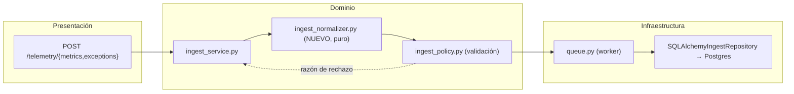
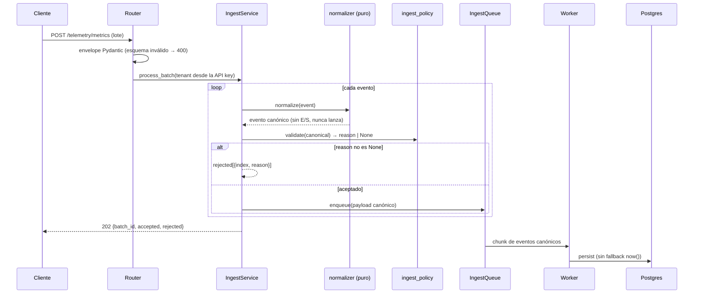

# Design: ISS-S3-02 — Normalización de datos de ingesta

**Cambio**: ISS-S3-02 (#41) · store: openspec · base `feat/ISS-S3-02` @ `1a46eb4` · r1.
**Specs**: `ingest-normalization` NORM-1..7, `architecture` ARCH-5/6. **Exploration/recomendación**: Enfoque 1.

## Enfoque técnico

Un `domain/services/ingest_normalizer.py` puro y sin E/S corre por evento dentro de `IngestService.process_batch` **antes** de `ingest_policy`, de modo que la validación de solo rechazo ve un evento ya canónico (ARCH-5, D2). La normalización resuelve **solo representaciones** — timestamps, alias de unidad, nombres, `error_type`, defaults definidos por el contrato, coerción de cadenas numéricas finitas — y nunca recorta magnitudes (D4, NORM-6). La validación sigue siendo la autoridad única de rechazo; la normalización nunca lanza excepciones y nunca realiza E/S. Los registros de unidad/tipo se definen una vez en `ingest_policy.py` y los importa el normalizador para prevenir derivas (R7). La coerción implícita post-`202` del worker y el fallback `now()` se eliminan; el payload canónico se encola. Sin DDL, sin migración.

## Contexto (vista de componentes)



## Secuencia — normalizar antes de validar



## Decisiones de arquitectura

| ADR | Decisión | Elección / alternativa rechazada | Justificación |
|---|---|---|---|
| [0004](../../../docs/adr/0004-normalize-before-validate.md) | Orden | Normalizar **antes** de validar (rechazado: orden literal del issue, normalizar en el worker) | Los alias/nombres deben resolverse antes de la política de solo rechazo; la validación sigue siendo autoridad única (ARCH-5, D2). |
| [0005](../../../docs/adr/0005-representation-only-normalization.md) | Solo representación | Nunca recortar magnitudes (rechazado: sanear a las cotas de sanity) | El TTFB de `9000ms` es la señal de anomalía (`ContratoIngestaRUM.md:30`, NORM-6). |
| [0006](../../../docs/adr/0006-error-type-in-code-catalog.md) | Catálogo de `error_type` | Mapa en código, desconocido → `Other`, sin DDL (rechazado: catálogo en BD + migración) | Fallback de baja cardinalidad sin migración/backfill (D3, NORM-4). |
| [0007](../../../docs/adr/0007-unit-alias-conversion.md) | Alias de unidad | Convertir alias declarado → canónico, indexado por la unidad declarada (rechazado: rechazar alias; re-derivar del valor) | La misma medición llega como `ms`/`s`; la conversión preserva la magnitud y es idempotente (D1, NORM-3). |

Los ADR son archivos Nygard en `docs/adr/0004..0007-*.md`.

## Interfaces / Contratos

```python
# ingest_policy.py — registros compartidos (fuente única, R7)
UNIT_CONVERSIONS: dict[str, tuple[str, float]] = {   # unidad declarada -> (canónica, factor)
    "ms": ("ms", 1.0), "msec": ("ms", 1.0), "millis": ("ms", 1.0),
    "s": ("ms", 1000.0), "sec": ("ms", 1000.0), "secs": ("ms", 1000.0),
    "count": ("count", 1.0), "counts": ("count", 1.0),
}
METRIC_TYPE_ALIASES: dict[str, str]   # alias con case-fold -> canónico UPPER_SNAKE
ERROR_TYPE_ALIASES: dict[str, str]    # alias con case-fold -> canónico
ERROR_TYPE_CATALOG: frozenset[str]    # builtins de ECMAScript + ejemplos del contrato + "Other"
COUNT_TYPES = frozenset({"JS_EXCEPTION_RATE", "RAGE_CLICK"})  # valores solo enteros

# ingest_normalizer.py — puro, nunca lanza, devuelve un dict NUEVO
def normalize_rum_event(event: dict) -> dict: ...
def normalize_js_exception(event: dict) -> dict: ...
def _canonical_ts(value: object) -> str | None: ...  # ISO-8601 UTC con tz, si no None
```

**Semántica**: `timestamp` de métrica ausente → hereda el `timestamp` del envelope; los valores naïve/no parseables pasan sin cambios para que `ingest_policy` los rechace (`invalid_timestamp`). Las unidades/nombres desconocidos pasan → `invalid_unit` / `invalid_metric_type`. La conversión de `unit` está indexada solo por la unidad declarada; la coherencia con `UNIT_BY_TYPE` sigue siendo responsabilidad de la validación. Los valores que no pueden coaccionarse (`NaN`, `Infinity`) pasan; la validación rechaza con `invalid_range`. `ingest_policy` además rechaza los valores de conteo no enteros y los números no finitos en `_in_range` / `_validate_metric`.

Composición en `ingest_service.py` (`:59-83`): `payload = event.model_dump(mode="json")` → `payload = normalizer(payload)` → `reason = validator(payload)` → rechazar o `enqueue(QueuedEvent(..., payload=payload))`.

## Archivos

| Archivo | Acción | Descripción |
|---|---|---|
| `src/api/domain/services/ingest_normalizer.py` | Crear | Normalización pura de RUM/JS. |
| `src/api/domain/services/ingest_policy.py` | Modificar | Registros compartidos; rechazar conteos no enteros / valores no finitos. |
| `src/api/domain/services/ingest_service.py` | Modificar | Insertar el paso de normalización antes de validar. |
| `src/api/infrastructure/ingest/queue.py` | Modificar | Quitar los fallbacks `float()`, `now()` y la precedencia de ts; parsear solo ts canónico. |
| `openspec/specs/openapi.yaml` | Modificar | Ampliar `RumMetric.unit`; nota de `error_type`. |
| `docs/adr/0004..0007-*.md`, `docs/adr/README.md` | Crear/Modificar | ADRs + índice. |
| `docs/architecture/{ContratoIngestaRUM,PipelineIngestaRUM}.md`, `CHANGELOG.md` | Modificar | Documentar flujo/flexibilidad. |
| `tests/test_ingest_normalizer.py` | Crear | Tests de unidad puros (NORM-1..7). |
| `tests/test_ingest_telemetry.py` | Modificar | Aceptación de alias; eliminación de `now()`. |

## Ampliación de OpenAPI (ARCH-6, R9)

El enum `RumMetric.unit` → `[ms, count, s, sec, secs, msec, millis, counts]`; la descripción declara que los alias se normalizan a las canónicas `ms`/`count`. La ampliación es retrocompatible. `JsExceptionEvent.error_type` permanece `string` (maxLength 100) con una nota en la descripción de que los valores se canonicalizan y los desconocidos → `Other`; no se agrega enum porque la normalización es flexible, no un rechazo.

## Idempotencia (R4)

La conversión está indexada por la unidad **declarada** y se aplica exactamente una vez: tras una pasada la unidad es canónica, por lo que una segunda pasada mapea `ms → (ms, ×1)` / `count → (count, ×1)` — un no-op. Un valor canónico nunca se reinterpreta. Los tests verifican `normalize(normalize(e)) == normalize(e)` para cada alias y que ×1000 se aplica una sola vez.

## Estrategia de testing

| Capa | Qué | Cómo |
|---|---|---|
| Unidad (`-m unit`) | NORM-1..7 por escenario; registros; idempotencia | `tests/test_ingest_normalizer.py` — sin BD, auto-marcado `unit` por el conftest. |
| Integración (`-m integration`) | `/telemetry/*` alias aceptado → canónico encolado y persistido; el worker persiste el ts canónico (sin `now()`) | httpx `client` + fixtures de Postgres. |
| Contrato | Enum `unit` ampliado aceptado; unidades desconocidas aún rechazadas | `test_contract.py` + schemathesis. |

TDD estricto (`config.yaml`): un test RED por escenario Given/When/Then antes de la implementación.

## Threat Matrix

N/A — sin routing, shell, subprocesos, automatización de VCS/PR, clasificación de archivos ejecutables ni límite de integración de procesos. El cambio transforma datos dentro de un handler HTTP en proceso existente.

## Migración / Rollout

No se requiere migración. Sin DDL (decisión c): `error_type` permanece `TEXT`, `rum_metric.unit` permanece `TEXT`. Solo hacia adelante, sin backfill; las filas canónicas ya almacenadas siguen siendo válidas. Rollback = revertir el único PR (el módulo es aditivo; la ampliación de OpenAPI se revierte en el mismo commit).

## Preguntas abiertas

- [ ] La cota de rechazo de timestamps futuros queda diferida (research §7): agregar una arriesga nuevos falsos rechazos; aquí no se introduce ninguna.
- [ ] Confirmar que no hay redondeo del lado del cliente de los valores `count` — el servidor rechaza los conteos no enteros (`invalid_range`, decisión f).
