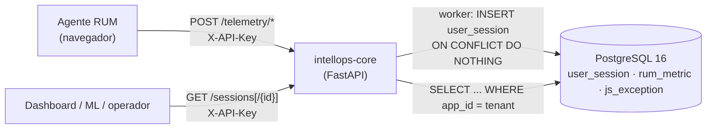
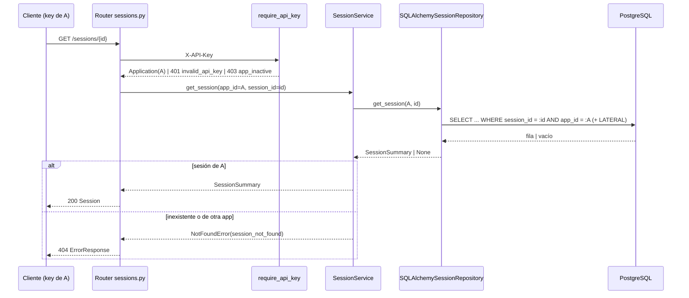

# Design: ISS-S3-03 — Gestión de sesiones (lectura app-scoped de `user_session`)

## Enfoque técnico

La escritura de sesiones ya existe en la ingesta (ADR-0002) y no se toca. Se agrega una lectura con la misma estructura en capas que el read path de métricas (ISS-S3-01):

```
router (require_api_key) → SessionService (límites) → SessionRepository (interfaz) → SQLAlchemySessionRepository (SQL)
```

El tenant entra como parámetro desde la `Application` autenticada y nunca sale del request.

## Contexto para nuevos integrantes



## Decisiones de arquitectura (ADR-0011, formato Nygard)

| # | Decisión | Alternativas | Trade-off y elección |
|---|----------|--------------|----------------------|
| DS-1 | Solo lectura: sin `POST /sessions` ni `/finish` | Implementar el EDT tal cual | La creación duplica la de la ingesta y el cierre no tiene respaldo en el contrato del agente. Se elige solo lectura. |
| DS-2 | El detalle filtra por `session_id` AND `app_id`; una sesión ajena da 404 | Buscar por PK y responder 403 si es ajena | El 403 confirma que la sesión existe bajo otro tenant. El 404 no filtra información. |
| DS-3 | Sin campos muertos en `Session` | Exponer `end_timestamp` y `duration_ms` como nullable | Un campo agregado después no rompe clientes; cambiarle el significado a un campo existente sí. Se excluyen. |
| DS-4 | `last_activity_at` calculado al consultar | Columna persistida o update en la ingesta | Calcularlo no requiere DDL ni tocar la ingesta, y es un dato real. Se calcula en SQL. |
| DS-5 | Acotar las sesiones antes de contar (subconsulta con `LIMIT`, luego `LATERAL`) | `LEFT JOIN` con `GROUP BY` sobre todas las sesiones de la ventana | Con `GROUP BY` se agregan filas de sesiones que el `LIMIT` después descarta. Acotar primero hace el costo proporcional al `limit`. |
| DS-6 | Ventana default de 24 h (no 15 min) | Reusar los 15 min de TQ-2 | Una sesión vive hasta 24 h en el agente; con 15 min el listado casi siempre vendría vacío. Se conserva el máximo de 7 días de TQ-2. |
| DS-7 | Errores de límites con `QueryRangeError` (422 `invalid_query_range`) | Un código nuevo | Mismo contrato que `/metrics/*`: el cliente maneja un solo código para "parámetros fuera de límite". |

## Consulta

```sql
SELECT t.session_id, t.app_id, t.start_timestamp, t.user_agent,
       m.total AS metric_count, e.total AS exception_count,
       GREATEST(m.last_ts, e.last_ts) AS last_activity_at
FROM (
    SELECT session_id, app_id, start_timestamp, user_agent
    FROM user_session
    WHERE app_id = :tenant AND start_timestamp >= :start AND start_timestamp < :end
    ORDER BY start_timestamp DESC, session_id DESC
    LIMIT :limit
) AS t
JOIN LATERAL (SELECT count(*) AS total, max(timestamp) AS last_ts
              FROM rum_metric WHERE session_id = t.session_id) AS m ON true
JOIN LATERAL (SELECT count(*) AS total, max(timestamp) AS last_ts
              FROM js_exception WHERE session_id = t.session_id) AS e ON true
ORDER BY t.start_timestamp DESC, t.session_id DESC;
```

- **Detalle**: la misma consulta, con la subconsulta filtrada por `session_id = :id AND app_id = :tenant`.
- **Por qué `ON true` no pierde sesiones**: un agregado sin `GROUP BY` siempre devuelve una fila (0 y NULL si no hay datos).
- **NULL en `GREATEST`**: PostgreSQL los ignora, así que basta con que haya filas en una sola de las dos tablas.
- **Índices**:
  - `idx_user_session_app_id` para el filtro por tenant.
  - `idx_rum_metric_session_timestamp` e `idx_js_exception_session_timestamp` para los conteos y el `max(timestamp)`.
  - Si el volumen del piloto lo pide, se agrega un índice `(app_id, start_timestamp DESC)` en una migración aparte.

## Secuencia



## Testing

| Capa | Archivo | Qué cubre |
|------|---------|-----------|
| Unit | `tests/test_sessions.py` | Límites antes de consultar, defaults (24 h, limit 50, UTC), 404 del servicio, `SessionOut` sin campos muertos |
| Integration | `tests/test_sessions.py` | Aislamiento por key, orden, conteos y `last_activity_at`, sesión sin actividad, ventana, limit, 404 entre tenants, 422 de UUID, 401 y 403, sesión creada por el worker con columnas NULL |
| Contract | `tests/test_contract.py` | Paths, respuestas, parámetros, schema `Session` sin campos muertos, sin escritura; `/sessions` dentro del subconjunto de schemathesis |

## Trade-offs de recursos

- Costo proporcional a `limit` (máximo 500) y no al tamaño de la ventana.
- Sin cachés, workers ni dependencias nuevas.
- Encaja en < 2 GB RAM y CPU-only sin cambios de infraestructura.
