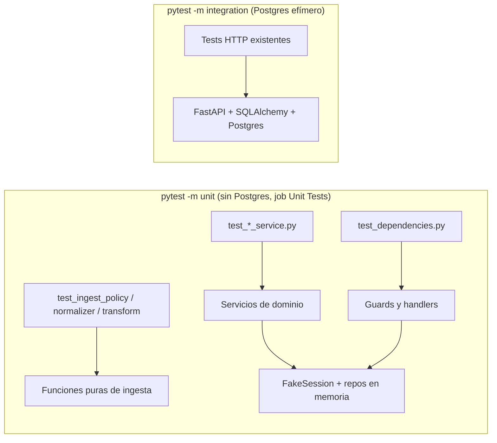

# Design: ISS-S3-06 — Pruebas unitarias de módulos críticos

## Enfoque técnico

Los servicios de dominio ya dependen de interfaces (`ApplicationRepository`, `UserRepository`) y reciben la `AsyncSession` por constructor. Eso permite probarlos sin Postgres con dobles que implementan la misma interfaz:

```
Test unitario ──> Servicio real ──> Repositorio en memoria (misma interfaz)
                        └────────> FakeSession (registra commit/rollback/refresh)
```

Los guards de `dependencies.py` construyen los repositorios SQLAlchemy por dentro, así que en esos tests se reemplazan las clases del módulo con `monkeypatch`, y las funciones se llaman directamente sin pasar por FastAPI.

## Contexto para nuevos integrantes



## Decisiones

| # | Decisión | Alternativas | Trade-off y elección |
|---|----------|--------------|----------------------|
| DT-1 | Meta por módulo crítico (≥ 90 %, validación y normalización 100 %) con la capa unitaria | Meta global de 70 % | La meta global ya se cumple y esconde los huecos de negocio y autorización. Se elige la meta por módulo. |
| DT-2 | Repositorios en memoria escritos a mano, uno por archivo de test | `unittest.mock.AsyncMock` | Los mocks automáticos aceptan cualquier llamada y no fallan si el servicio llama a un método inexistente. Un doble explícito implementa la interfaz real y deja estado verificable. |
| DT-3 | `FakeSession` compartida como fixture en `conftest.py` | Duplicarla en cada archivo | Es la misma para todos los servicios. El repo no tiene módulos de helpers importables, y `conftest.py` es el lugar donde ya viven las fixtures compartidas. |
| DT-4 | `PasswordHasher` real (argon2) en los tests | Hasher falso | Verifica que de verdad se guarda un hash argon2 y que verifica. En `test_auth_service.py` el hash se calcula una vez por módulo para que el costo de argon2 no pese. |
| DT-5 | Bug encontrado → `xfail(strict=True)` y fix aparte | Corregirlo en esta PR | La issue es solo de tests. El `xfail` estricto documenta el bug y obliga a quitar la marca cuando se corrija. |

## Bug encontrado

`ApplicationService.create_application` construye la entidad con `name` y `description`, e ignora `ApplicationCreate.is_active`, que el contrato declara (APP-7, default `true`). Un `POST /applications` con `is_active: false` crea la app activa. Queda fijado en `test_create_application_honours_is_active_false` con `xfail(strict=True)` y se corrige en un cambio aparte.

## Testing

| Archivo | Módulo | Casos |
|---------|--------|-------|
| `test_ingest_policy.py` | `ingest_policy` | UUID nativo y tipos inesperados, `datetime` aware/naive, epoch numérico, métricas que no son objeto o con campos faltantes, `metric_id` inválido, booleanos como valor |
| `test_ingest_normalizer.py` | `ingest_normalizer` | Tipos que no son string, métricas que no son objeto, `metrics` que no es lista, unidad desconocida, valor no finito con alias |
| `test_metrics_query.py` | `query_service`, `_as_int` | Delegación del catálogo, default y bordes de `limit`, normalización a UTC, parseo de `metadata` |
| `test_application_service.py` | `application_service` | CRUD con 404, rollback del 409 por FK, emisión y revocación de key, autenticación |
| `test_user_service.py` | `user_service` | Alta con hash, rol inexistente, email duplicado, re-hash solo con password, 404 con rollback |
| `test_auth_service.py` | `auth_service` | Login OK, anti-enumeración, `DUMMY_HASH`, inactivo 403 vs 401, logout |
| `test_dependencies.py` | `dependencies`, `errors` | Tokens inválidos, usuario inexistente o inactivo, roles, API key, ErrorResponse y 422→400 |
| `test_ingest_transform.py` | `queue` | `_parse_ts`, `_build_rows` (sesión por chunk, tenant de la key, `user_agent`, `page_url`, excepciones), contadores de `_persist_chunk` |
| `test_ingest_telemetry.py` | `ingest_service` | Gauge de profundidad de cola con `qsize` presente, ausente o que falla |
| `test_ml_dataset_reader.py` | `api_reader` | 4xx con cuerpo que no es ErrorResponse |

## Trade-offs de recursos

Unos 140 tests nuevos que agregan menos de 5 s a la suite unitaria (argon2 domina). Sin dependencias, sin servicios externos.
